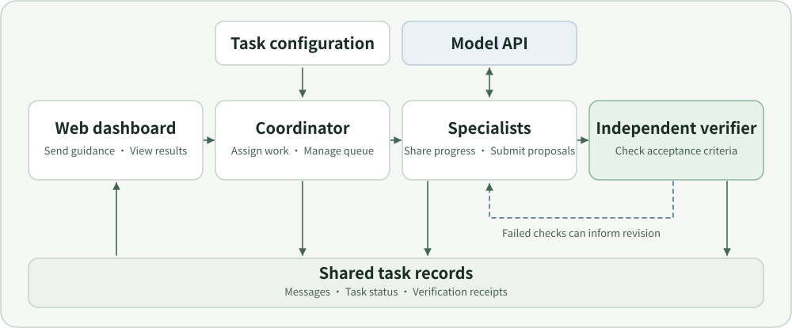

# Tianwen Agent framework

[Project README](../) · [简体中文](README.zh-CN.md)

The coordinator schedules specialists for a shared task. An independent verifier checks candidates submitted for verification against the task’s acceptance criteria. Operators can send guidance from the web dashboard and review messages, task status, and verification records there.

[Open full-size diagram](architecture.svg)

## How a task runs

1. **Configure and start the task.** The operator sets the goal and acceptance criteria in the task configuration and starts the run from the command line. The coordinator queues the specialists’ work.
2. **Propose a result.** A specialist reads the task and relevant messages, calls the configured model, and submits a candidate or shares progress with other roles.
3. **Verify and report.** An independent verifier checks the submission and records the outcome. Feedback from a failed check can inform the next proposal. The dashboard shows the record for review.

The planned release will use an API key supplied by the operator. GLM is the example provider, with support for other OpenAI-compatible providers planned through a configurable API base URL and model name.

## Local preview

The local demo uses the original dashboard template with a synthetic arithmetic task. It shows a proposal failing verification, a revised proposal passing, and both outcomes appearing in the dashboard. The default demo runs offline. The optional GLM example has only been tested with simulated responses.
