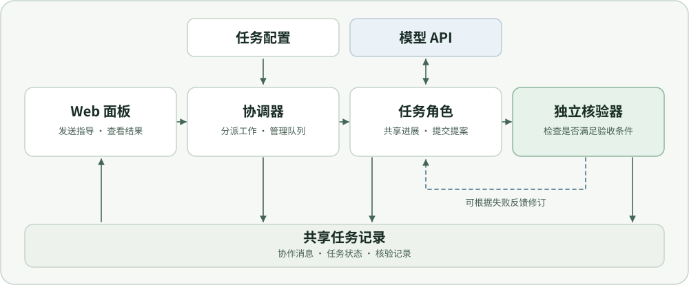

# 天问 Agent 框架

[项目 README](../) · [English](README.md)

协调器围绕同一任务调度多个角色。独立核验器按任务的验收条件检查送交核验的候选结果。操作者可通过 Web 面板发送指导，并查看协作消息、任务状态和核验记录。

[查看原尺寸架构图](architecture.zh-CN.svg)

## 一个任务如何运行

1. **配置并启动任务。** 操作者在任务配置中定义目标和验收条件，从命令行启动任务。协调器将各角色的工作加入队列。
2. **提出结果。** 任务角色读取目标和相关消息，调用已配置的模型，提交候选结果或与其他角色共享进展。
3. **独立核验。** 核验器检查提交内容并记录结果。校验失败时，角色可以根据反馈修订提案。操作者可在面板中查看核验记录。

计划发布的版本使用操作者自己的 API 密钥，以 GLM 为接入示例。我们也计划支持通过配置 API 基础地址和模型名称，接入其他兼容 OpenAI 接口的服务商。

## 本地预览

本地预览沿用原版 Web 面板，使用虚构的算术任务演示提案未通过、修订后通过，以及面板中如何查看两次核验结果。默认示例离线运行，可选的 GLM 示例目前仅用模拟响应验证过。
